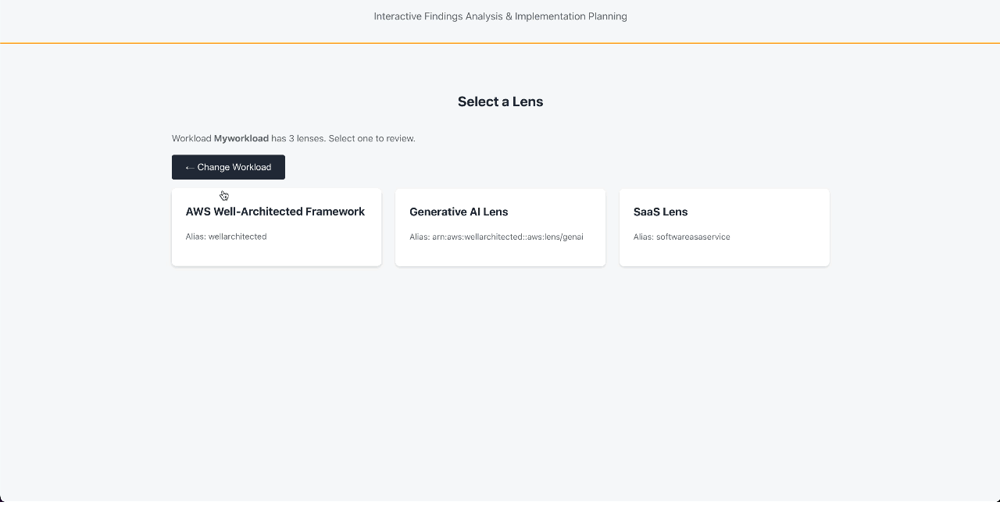

# WASP — Well-Architected Summary Producer 🐝

WASP (Well-Architected Summary Producer) is an interactive sample tool for every step following an AWS Well-Architected Framework Review (WAFR). Prioritise findings, get AI recommendations, ask questions, and track your entire post-review remediation journey from a UI that persists your updates. Use it independently or together with your AWS Solutions Architect.

### Demo 1: Core Workflow



## Introduction

WASP is designed as an interactive prioritization tool and tracker following the completion of a WAFR. It reads live WAFR data, letting you visually prioritise findings on an Eisenhower matrix, and write results back to the AWS Well-Architected Tool as milestones. With AI Mode enabled, it generates executive summaries, summarises AWS best practice documentation, answers follow-up questions, and recommends prioritisations, all powered by Amazon Bedrock.

## Architecture Components

- **Frontend**: React single-page application hosted on Amazon CloudFront + private Amazon S3 bucket (Origin Access Control)
- **Backend**: Python AWS Lambda functions behind Amazon API Gateway (REST)
- **Auth**: Amazon Cognito User Pool with Hosted UI (invite-only)
- **State**: Amazon DynamoDB (AWS KMS-encrypted, pay-per-request)
- **AI**: Amazon Bedrock Converse API (optional, on-demand models)
- **Infra**: AWS CDK (TypeScript) — single-command deployment

> **Note**: Amazon Cognito is used in this sample. For production workloads, consider integrating with your organisation's identity provider via SAML or OIDC federation.

For detailed architecture diagrams, see the [Architecture Guide](docs/ARCHITECTURE.md).

### Demo 2: AI Workflow


## Deployment Instructions

### Prerequisites

| Requirement | Version | Check |
|-------------|---------|-------|
| Node.js | 18+ | `node --version` |
| npm | 9+ | `npm --version` |
| Python | 3.10+ | `python3 --version` |
| AWS CDK | 2.x | `npx cdk --version` |
| AWS CLI | 2.x | `aws --version` |
| Docker | — | `docker --version` |
| AWS credentials | — | `aws sts get-caller-identity` |

You also need at least one workload in the [AWS Well-Architected Tool](https://console.aws.amazon.com/wellarchitected/).

### Quickstart

```bash
cd frontend && npm install && npm run build && cd ..
cd cdk && npm install && npx cdk bootstrap -c adminEmail=you@example.com && npx cdk deploy -c adminEmail=you@example.com
```

> Requires Python 3.10+, Node 18+, and Docker (for AWS Lambda bundling).

For full instructions see the [Deployment Guide](docs/deployment.md).

### Using the Application

1. Check your email for the temporary Amazon Cognito password
2. Visit the Amazon CloudFront URL from the AWS CDK output
3. Sign in with your email and temporary password (you'll set a new one)
4. See the [Usage Guide](docs/Usage%20Guide.md) for a full walkthrough

## Contributing

Contributions are welcome. We're particularly interested in:

- Additional lens support and best practice URL patterns
- UI/UX improvements for the prioritisation workflow
- AI prompt optimisation for better summaries
- Documentation improvements and translations

Please read the [code of conduct](CODE_OF_CONDUCT.md) and the [contributing guidelines](CONTRIBUTING.md) before submitting your contribution.

## Recommendations for Implementation

This sample is designed for demonstration and learning, not for production environments. For implementation, consider the following non-exhaustive list:

| Category | Recommendation |
|----------|---------------|
| Perimeter | Add AWS WAFv2 web ACL to both Amazon API Gateway and Amazon CloudFront |
| Perimeter | Add geo restrictions on Amazon CloudFront to limit access to expected regions |
| Perimeter | Use a custom domain with an ACM certificate on Amazon CloudFront for TLS best practices |
| Validation | Enable API Gateway request validation for input schema enforcement |
| Cost Protection | Set AWS billing alarms and Amazon Bedrock service quota limits |

## Disclaimer

This sample code is provided for demonstration and educational purposes only, and should NOT be deployed to production environments without additional security testing and hardening. Use this code at your own risk. AWS does not provide support for this sample.

## License

This library is licensed under the MIT-0 License. See the [LICENSE](LICENSE) file.
