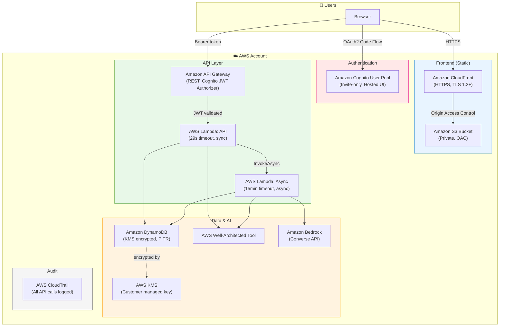
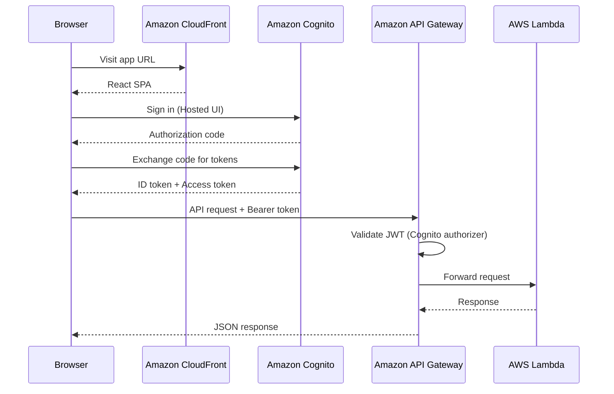
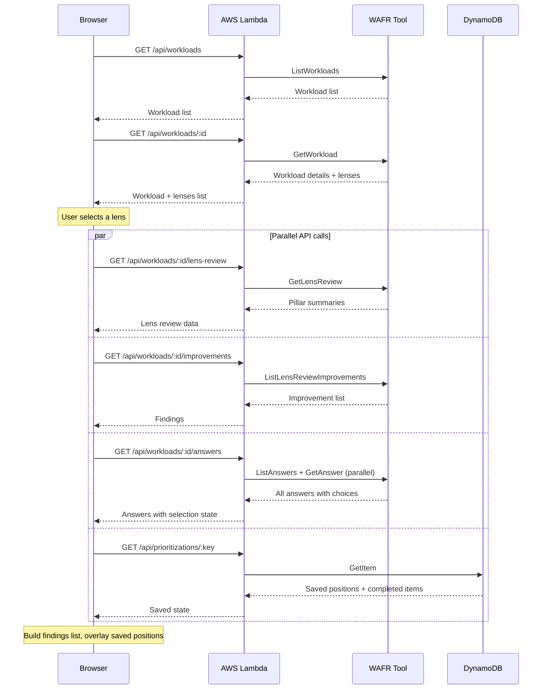
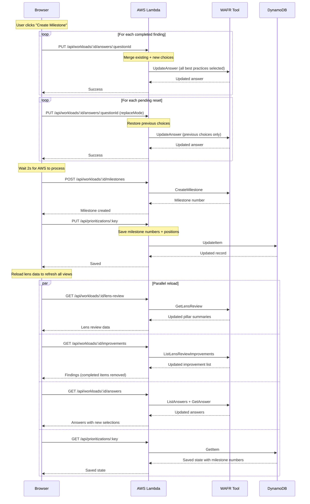
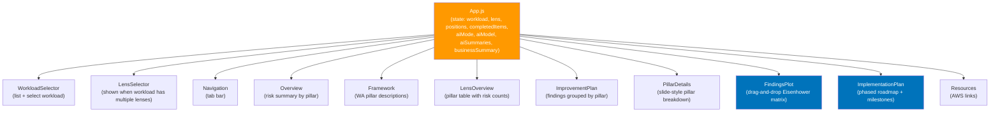
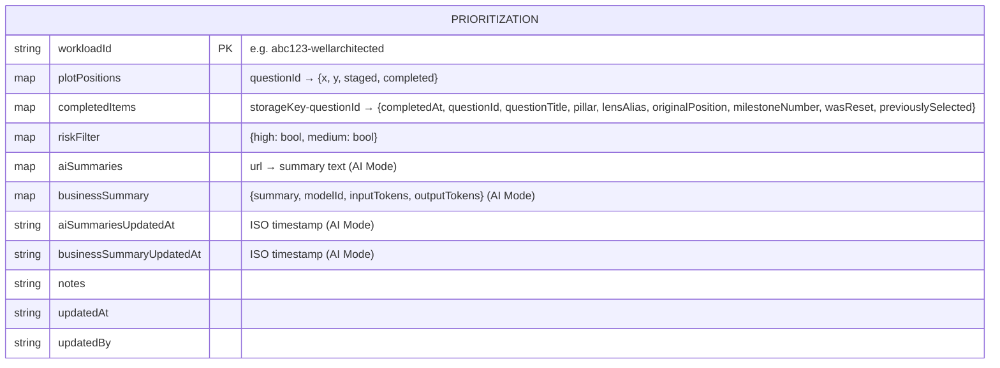
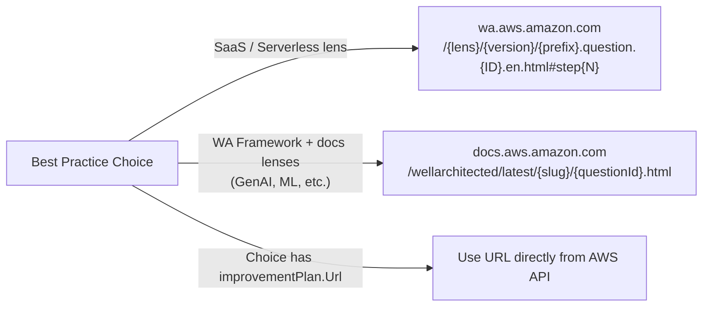
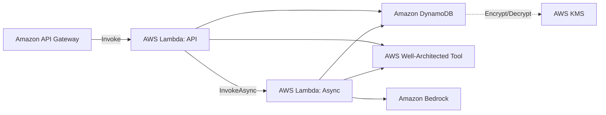

# WASP Architecture

## System Overview

WASP is a fully serverless application deployed in your AWS account via CDK. Users access a React frontend served by CloudFront, authenticate via Cognito Hosted UI, and interact with a Python Lambda backend through API Gateway.

---

## Authentication Flow

Users authenticate via Amazon Cognito Hosted UI. Amazon API Gateway validates JWT tokens before requests reach AWS Lambda.

---

## Data Flow — Loading a Workload

When a user selects a workload and lens, four API calls fire in parallel to minimise load time.

---

## Data Flow — Creating a Milestone

---

## Frontend Component Tree

---

## DynamoDB Data Model

Each record is keyed by `{workloadId}-{sanitizedLensAlias}` so each workload+lens combination has its own saved state.

**plotPositions** — keyed by `questionId`, stores the x/y coordinates on the 600×600 plot:
- `staged: true` → circle is in the right-hand staging area (not yet placed)
- `completed: true` → circle is in the completed zone below the plot
- `x, y` → pixel coordinates on the plot canvas

**completedItems** — keyed by `{storageKey}-{questionId}`:
- `completedAt` — ISO timestamp when the item was marked complete
- `questionId` — the WAFR question ID
- `questionTitle` — human-readable question title
- `pillar` — which WA pillar this question belongs to
- `lensAlias` — which lens this completion belongs to
- `originalPosition` — the x/y plot position before completion (used to keep the item in its quadrant)
- `milestoneNumber` — set when the item was locked into a milestone
- `wasReset` — set when the item was un-completed via "Reset Question"
- `previouslySelected` — the choices that were selected before completion (used to restore on reset)

---

## URL Scheme for Best Practice Links

Different lenses use different documentation URL patterns:

---

## IAM Permission Model

Lambda execution roles are scoped per-function:
- WAFR write actions restricted to `arn:aws:wellarchitected:*:ACCOUNT:workload/*`
- DynamoDB scoped to the specific prioritization table
- KMS scoped to the table encryption key
- Bedrock runtime scoped to `arn:aws:bedrock:REGION::foundation-model/*`
- Only the API Lambda can invoke the Async Lambda (no other callers)

---

### Key Design Decisions

| Decision | Rationale |
|----------|-----------|
| **Serverless compute** | Lambda scales to zero — no idle cost, no servers to patch |
| **CloudFront + private S3** | Static frontend served via CDN with OAC — no public bucket |
| **Cognito invite-only** | No self-signup, admin creates users — suitable for team use |
| **API Gateway + JWT authorizer** | Auth validated at gateway level — Lambda never sees unauthenticated requests |
| **Async Lambda for AI** | 15-minute timeout for summary generation — avoids API Gateway 29s limit |
| **DynamoDB for state** | Serverless, pay-per-request, KMS encrypted, point-in-time recovery |
| **Per-lens storage key** | `{workloadId}-{lensAlias}` isolates state between lenses |
| **Parallel API calls** | Loading a lens fires 4 API calls simultaneously to minimise perceived latency |
| **Debounced auto-save** | 3-second debounce on drag events prevents excessive DynamoDB writes |
| **AI Mode via Bedrock** | Uses the Converse API for model-agnostic inference |
| **Editable prompt templates** | Prompts are plain text files — edit and redeploy to customise AI behaviour |
| **AI summary caching** | Per-URL and per-workload/lens caching avoids redundant Bedrock calls |

