# WASP Usage Guide 🐝

A visual walkthrough of the WASP (Well-Architected Summary Producer) user journey, from selecting a workload through to creating milestones and resetting questions.

---

## 1. Select a Workload

When you open WASP, you land on the workload selector. All workloads from your AWS Well-Architected Tool account are displayed as cards in a grid. Each card shows the workload name, owner ID, last updated date, and a count of high and medium risk findings. Choose a card to select it.

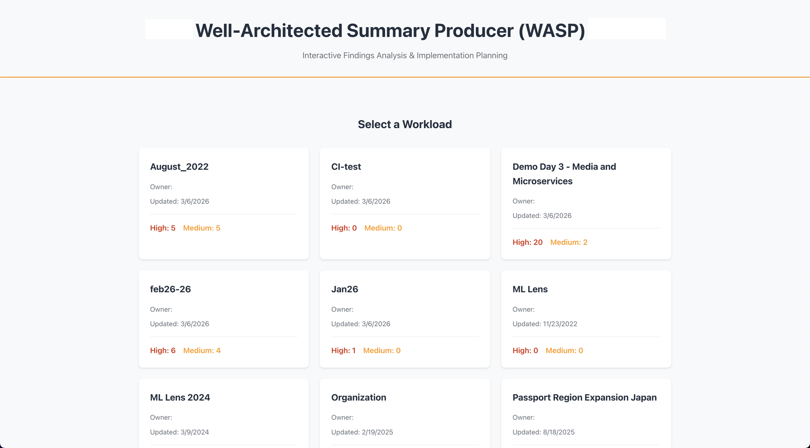

---

## 2. Select a Lens

If the workload has multiple lenses attached, you'll be prompted to choose which one to review. The page shows the workload name, a "← Change Workload" button to go back, and a card for each available lens (e.g. "AWS Well-Architected Framework" and "Serverless Lens"). Choose a lens card to load its review data.

If the workload only has one lens, this step is skipped automatically.

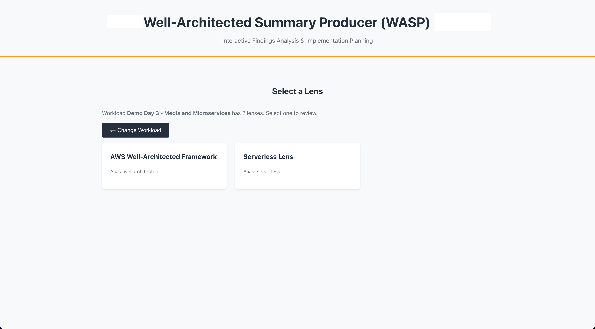

---

## 3. Lens Overview

The Lens Overview tab shows a high-level summary of the review. At the top is the total number of questions answered (e.g. "26/57") and the lens version. Below is a summary table with one row per pillar, showing the number of questions answered and the count of High risk, Medium risk, No identified risk, and Not applicable findings. Risk counts are colour-coded — red for high, yellow for medium. A "Lens notes" banner at the bottom flags how many questions remain unanswered.

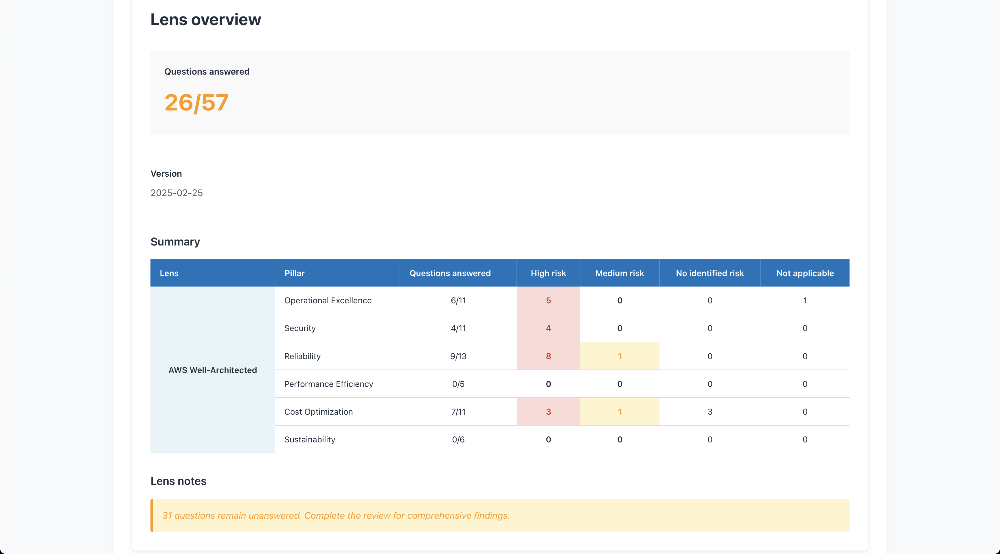

---

## 4. Improvement Plan — Summary

Navigate to the Improvement Plan tab using the navigation bar. This page opens with risk summary boxes showing the total count of High risk and Medium risk findings. Filter buttons let you show Both, High Risk Only, or Medium Risk Only. Below is the "Improvement item summary" table listing each pillar with its high and medium risk counts.

The navigation bar across the top provides access to all tabs: Overview, Framework, Lens Overview, Improvement Plan, Pillar Details, Prioritise Findings, Implementation Plan, and Resources.

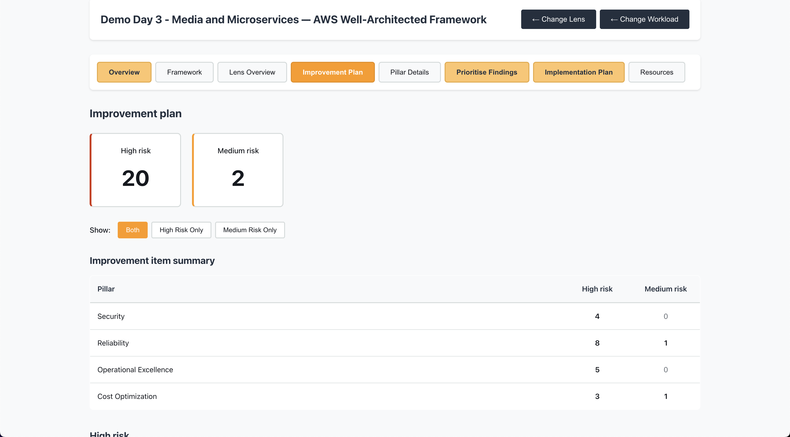

---

## 5. Prioritise Findings — Eisenhower Matrix

The Prioritise Findings tab is the core of WASP. Each finding appears as a numbered circle — red for high risk, orange for medium risk. Drag circles from the staging area on the right onto the four-quadrant matrix:

| Quadrant | Position | Meaning |
|----------|----------|---------|
| Quick Wins | Bottom-right | High Impact, Low Complexity — do first |
| Major Tasks | Top-right | High Impact, High Complexity — plan carefully |
| Incremental Tasks | Bottom-left | Low Impact, Low Complexity — ongoing work |
| Low Priority | Top-left | Low Impact, High Complexity — do last |

The Findings Key on the far right lists each finding with its question ID, title, recommended best practices (linked to AWS docs), and a "→ View in Improvement Plan" link. Below the plot is a "Previously Completed Since Last Milestone" drop zone where you can drag items to mark them as done.

Positions auto-save to DynamoDB 3 seconds after your last drag.

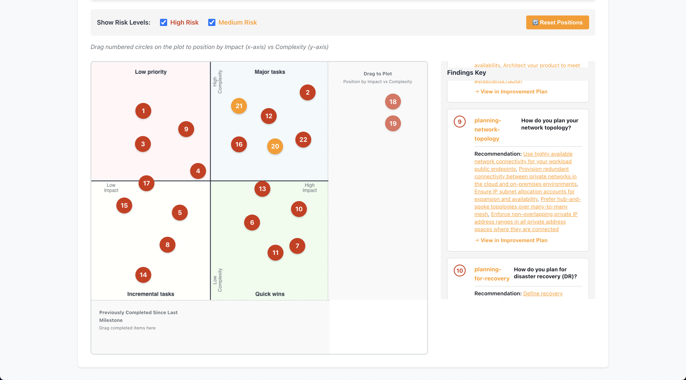

---

## 6. Improvement Plan — Finding Details

Scrolling down on the Improvement Plan tab reveals the individual findings grouped by pillar and risk level. Each finding shows the question title and a list of unimplemented best practices — each one is an orange link that opens the relevant AWS documentation page. A "View in Plot" button on each finding jumps you to that item on the Eisenhower matrix.

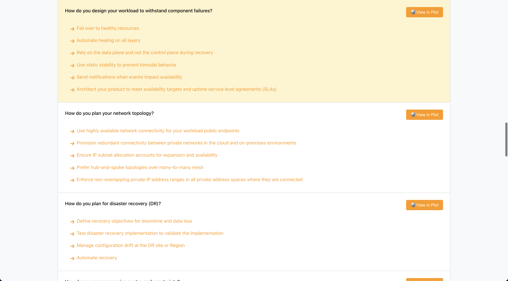

---

## 7. AWS Documentation — Best Practice Detail

Choosing a best practice link from WASP opens the corresponding AWS documentation page. This example shows "REL11-BP02 Fail over to healthy resources" with the full guidance text, desired outcomes, common anti-patterns, and a sidebar with recommended tasks and related learning resources. Use this to understand exactly what needs implementing for each finding.

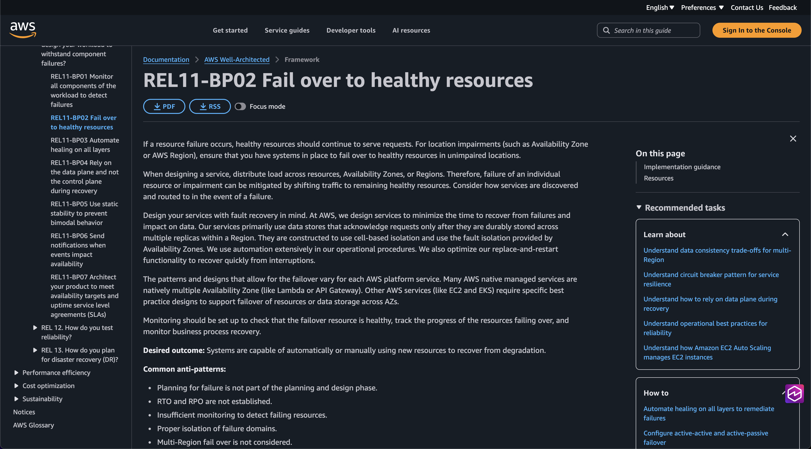

---

## 8. Implementation Plan — Phased Roadmap

The Implementation Plan tab automatically categorises your prioritised findings into phases based on their position on the Eisenhower matrix. The page shows a summary line (e.g. "4 Quick Wins, 7 Major Tasks, 4 Incremental, 5 Low Priority") and the "📸 Create Milestone" button.

Each phase lists its findings with a checkbox, finding number, question title and ID, risk level, pillar, priority (Impact/Complexity), plot coordinates, and links to "View in Improvement Plan" and "View in Plot".

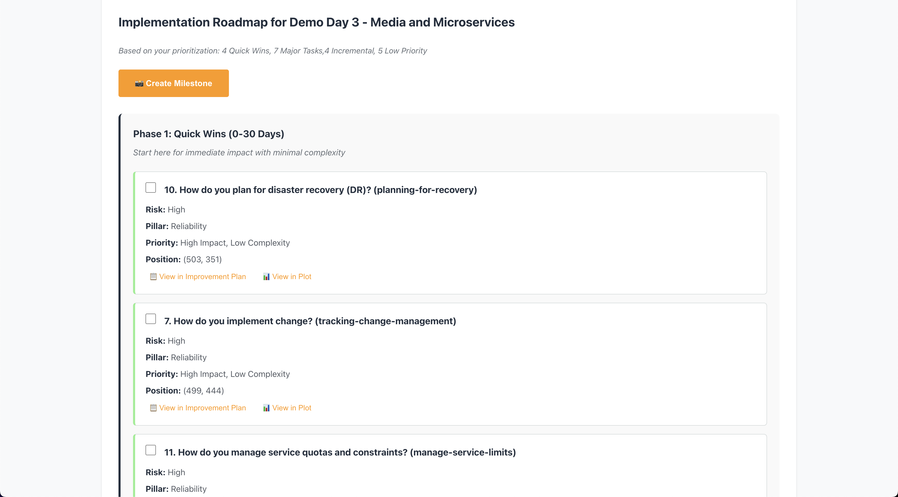

---

## 9. Mark Items as Complete

To mark a finding as done, tick its checkbox or drag it to the completed zone on the plot. Completed items move to a green-highlighted "✅ Completed Since Last Milestone" section at the bottom of the Implementation Plan. Each completed item shows a checked checkbox, strikethrough title, completion date, and its original priority details. These items will be finalised when you next create a milestone.

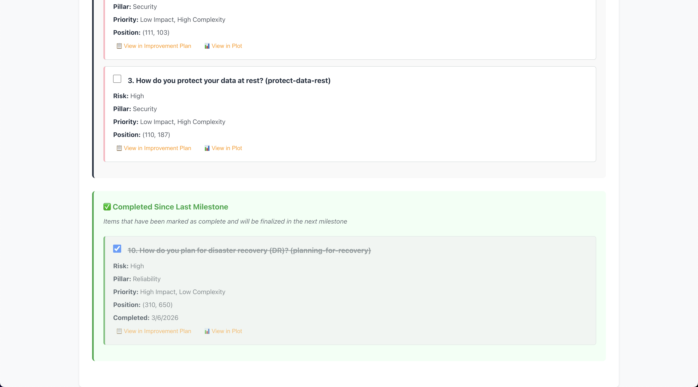

---

## 10. Create a Milestone — Prior Milestones

After choosing "📸 Create Milestone", WASP selects all best practices for each completed finding in the AWS WAFR Tool, then creates a milestone snapshot. Completed items move to the "Previously Completed in Prior Milestones" section with a milestone badge (e.g. "Milestone #6"), Risk shown as "Resolved", and a disabled checkbox — these items can no longer be modified directly.

If you need to revisit a completed question, choose the "🔄 Reset Question — revert to previous answers" link to queue it for reset.

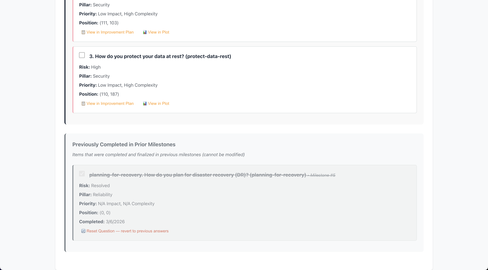

---

## 11. Reset a Question

After choosing "Reset Question", the item is queued for reset — not applied immediately. A red-highlighted "⏳ To Be Marked Uncompleted" section appears showing the queued item with an "↩️ Undo Reset" link in case you change your mind. The item in the Prior Milestones section also updates to show "⏳ Queued for reset — choose Create Milestone to apply".

When you next choose "📸 Create Milestone", WASP restores the question's previous answer state in the WAFR Tool and moves the item back to the staging area on the Eisenhower matrix for re-prioritisation.

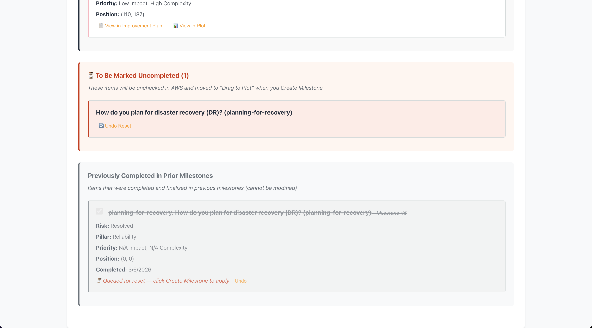

---

## Tips

- **Auto-save**: Plot positions save automatically 3 seconds after your last drag. An orange "Unsaved changes" indicator appears while a save is pending.
- **Multi-lens**: Each workload+lens combination has its own saved positions and completed items.
- **Highlight**: Choose a circle on the plot to highlight its entry in the Findings Key, making it easy to read the details.
- **Reset all**: Use the "🔄 Reset Positions" button to move all circles back to the staging area.
- **Cross-reference**: Use the "View in Improvement Plan" and "View in Plot" links to jump between pages.
- **Direct links**: Every best practice links directly to the AWS documentation for that specific remediation step.

---

## AI Mode

WASP includes an optional AI Mode powered by Amazon Bedrock. Enable it using the "AI Mode" toggle in the top banner, then select a model from the dropdown. The dropdown shows on-demand Bedrock models available in your account's region, with end-of-life models filtered out.

All AI-generated content is for informational purposes only. Generative AI can make mistakes — always verify against the source documentation.

---

### 12. Enable AI Mode

Toggle "AI Mode" on in the top banner. A model selector dropdown appears showing all available Bedrock on-demand models in your account (Anthropic Claude, Amazon Nova, Meta Llama, Mistral, etc.). Select a model to enable AI features across the app. The toggle and selector persist while you navigate between tabs.

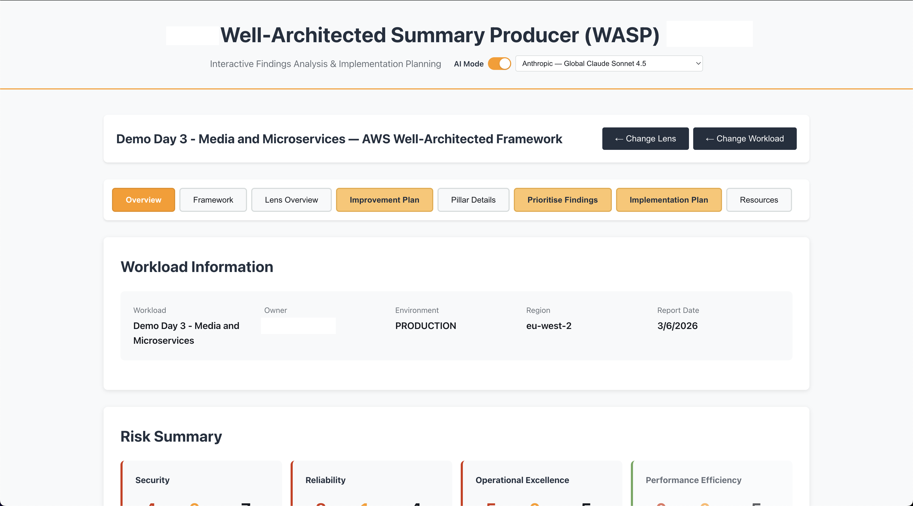

---

### 13. Model Selector

Choose the dropdown to browse all available models. Models are grouped by provider and sorted alphabetically. End-of-life models and non-text models are automatically filtered out. Only foundation models in the deployment region are shown — cross-region inference profiles are not used.

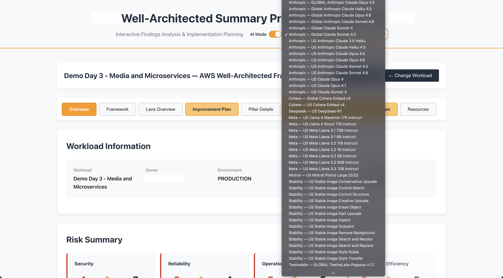

---

### 14. Generate Business Summary

With AI Mode enabled, the Overview tab shows a "Business Summary" section below the Risk Summary. Choose "Generate Summary" to create an executive-friendly summary of the review. The AI disclaimer reminds you that the output is for informational purposes only.

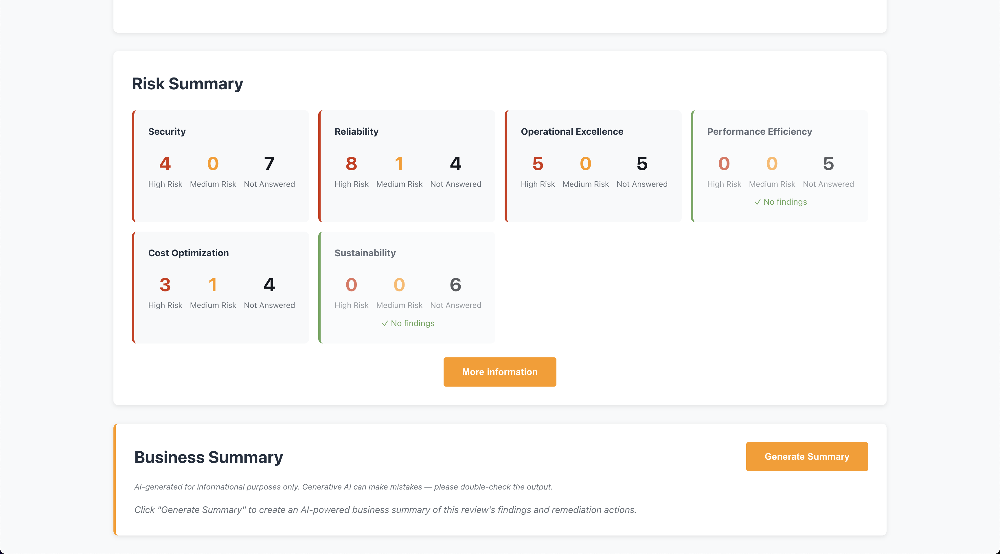

---

### 15. Business Summary — Executive Overview

The generated summary covers the workload's business context, risk posture, critical findings requiring immediate action, and remediation priorities. It uses markdown formatting with headings, bullet points, and bold text for readability. The "Regenerate" button creates a fresh summary. The summary is cached in DynamoDB — returning to this page loads it instantly.

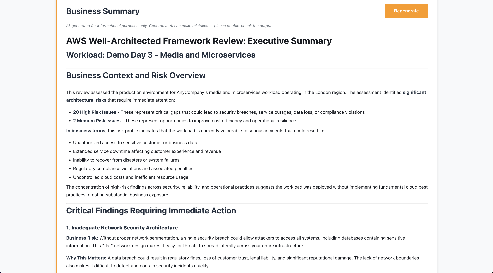

---

### 16. Business Summary — Conclusion and Next Steps

The bottom of the summary includes medium-term actions, a conclusion, and recommended next steps. Below the summary, the model ID and token usage (input/output) are displayed. If the summary was loaded from cache, a "(cached)" indicator appears.

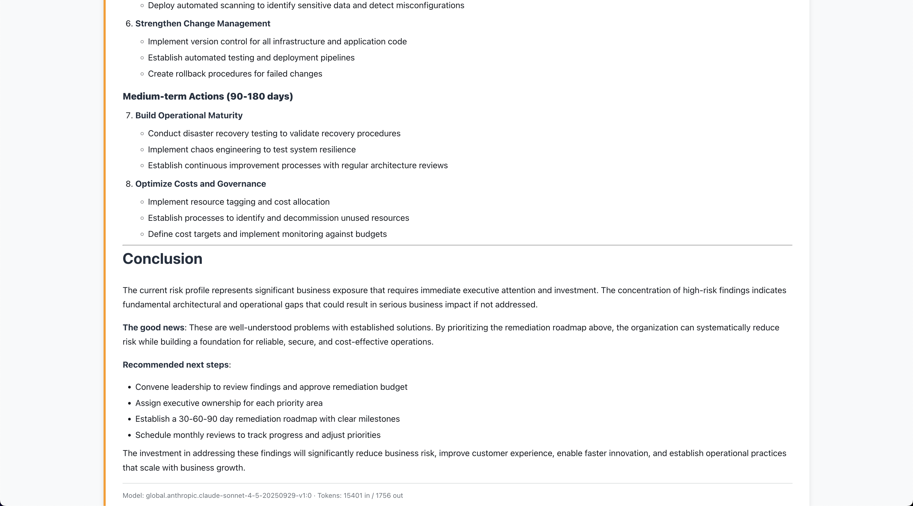

---

### 17. Q&A — Ask Follow-up Questions

After generating a business summary, a Q&A chat interface appears below it. Type a question and choose "Ask" — the model has full context of the business summary, all findings, and remediation actions. Questions appear as dark bubbles on the right, answers as light bubbles on the left with markdown formatting.

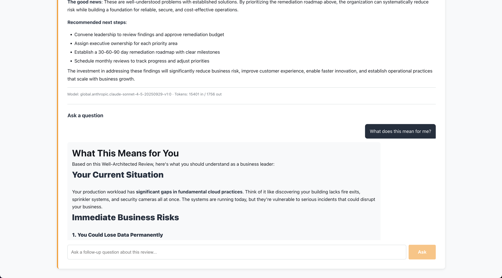

---

### 18. Improvement Plan — AI Summaries

When a business summary is generated, WASP also fetches the AWS documentation page for each best practice and summarises it via Bedrock. These summaries appear inline below each best practice link on the Improvement Plan tab, highlighted with an orange left border. Summaries are cached in DynamoDB and load automatically on subsequent visits.

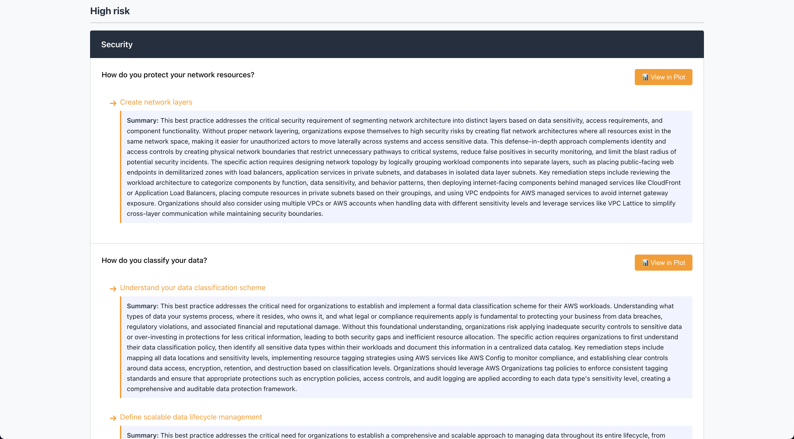

---

### 19. Recommend Positions — Before

With AI Mode enabled, a "Recommend Positions" button appears next to "Reset Positions" on the Prioritise Findings tab. All findings start in the staging area on the right.

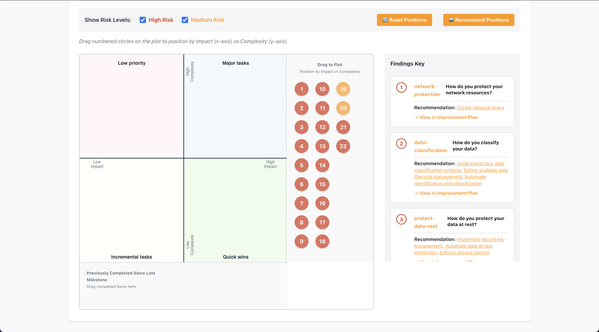

---

### 20. Recommend Positions — Confirmation

Choosing "Recommend Positions" shows a confirmation dialog warning that it will overwrite all current positions. The AI disclaimer is included. Choose "Confirm" to proceed or "Cancel" to abort.

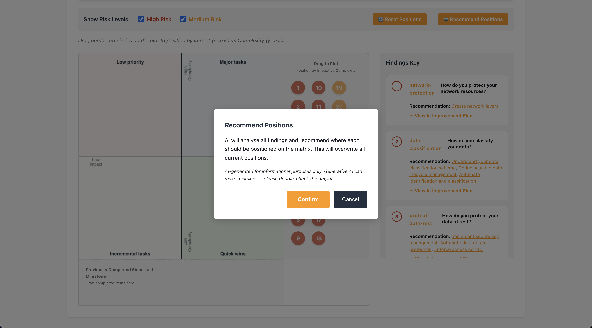

---

### 21. Recommend Positions — Result

After confirmation, the AI analyses all findings using the business summary and best practice summaries, then places each finding on the Eisenhower matrix. Findings are spread across all four quadrants based on independently assessed impact and complexity. You can drag any finding to adjust its position after the AI recommendation.

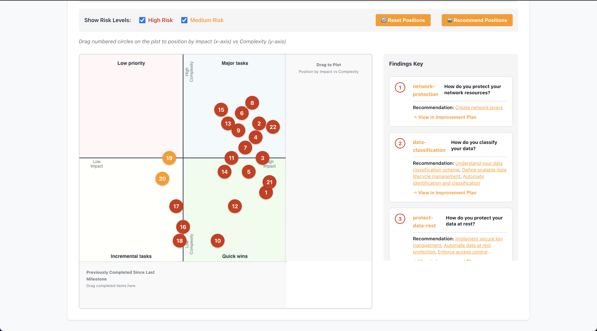

---

### Prompt Templates

All AI prompts are stored as editable text files in `backend/prompts/`. Changes take effect immediately on the next API call — no restart needed. See the [README](README.md#prompt-templates) for the full list.
